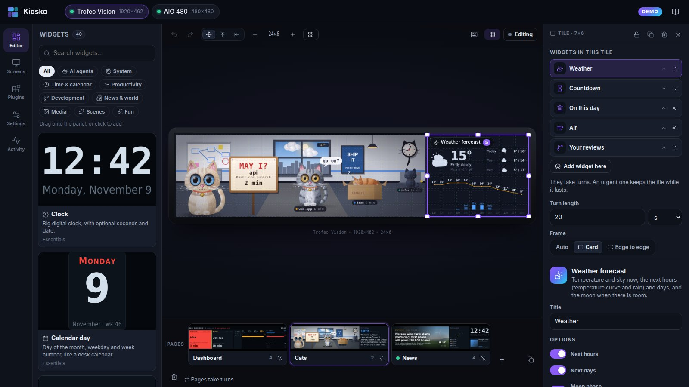
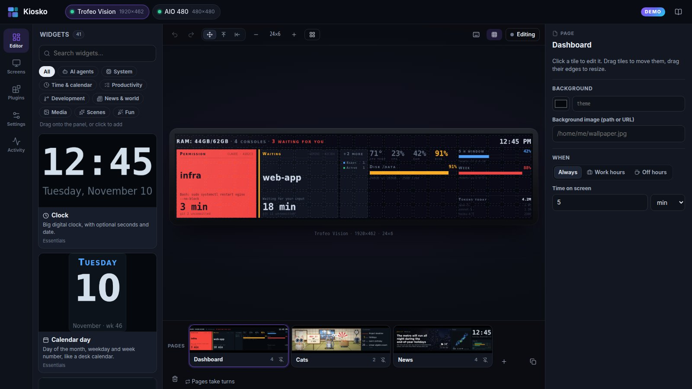
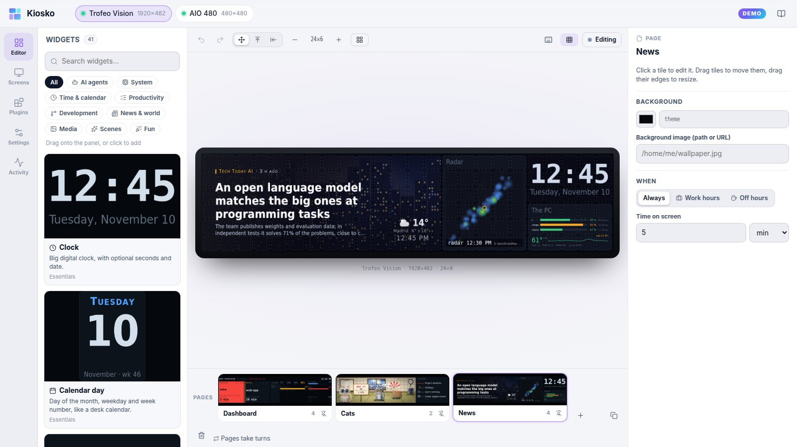
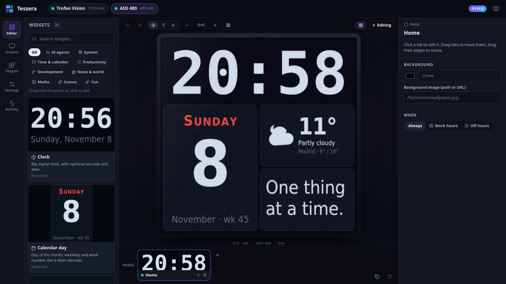
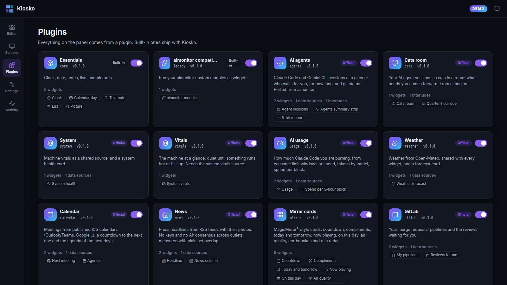

# Kiosko

**A widget mosaic for small always-on USB LCD panels**: Thermalright Trofeo
Vision and its 1920×462 siblings, square AIO screens, cheap 320×240 displays…
Lay out widgets on a grid with a visual editor, stack them so they take turns,
and let a tiny daemon keep the panel up to date.

> 🇪🇸 Documento de diseño en castellano: [docs/es/plan.md](docs/es/plan.md)



- **Visual editor in your browser.** Drag widgets onto a to-scale picture of
  your panel, resize them on the grid, drop one onto another to stack them.
  What you see is painted by the same code that paints the panel.
- **Plugins all the way down.** Every widget, data source and full-screen
  animation is a plugin with the same small contract. Write one in a single
  file; no build step, no `npm install`.
- **Made for LCDs that stay on.** Event-driven repaints (no fixed frame rate),
  identical frames are never re-sent, pixel shift against burn-in, black
  panel when everything is idle, a semaphore palette where darkness is the
  normal state.
- **The editor runs anywhere, and so does the panel (USB, experimental).** The
  editor, the server and the painting run on Linux, macOS and Windows (Node.js
  and a browser; fonts are bundled so a frame is pixel-identical on every OS),
  and **Windows has an installer** that needs no Node.js ([below](#windows)).
  The **USB** connection drives LY panels (Trofeo Vision 9.16 and siblings)
  from Node itself, with no Python and no `trcc`; see [docs/usb.md](docs/usb.md)
  for what each OS needs. The other connections (`trcc serve`, frame files)
  still work and are the ones tested on a real panel for months.

| | |
|---|---|
|  |  |
|  |  |

## Try it in your browser

**<https://kioskolcd.dev/demo/>**: the real editor, running entirely in your
browser with sample data. Lay out the sample screens, add widgets, switch
themes and languages; nothing is installed and your changes stay in that
browser. What needs a machine (a real panel, plugins from npm, live data) is
switched off there.

## Try it in 30 seconds

```sh
git clone https://github.com/kiosko-lcd/kiosko && cd kiosko
npm install
npm run web:build
node --conditions=source packages/server/src/cli.ts start --config examples/showcase.json --demo --open
```

`--demo` paints every widget with sample data and reads nothing from your
machine, so you can explore the editor before connecting a panel.

## Quick start

```sh
npm install -g kiosko     # Node.js 22.18 or newer
kiosko start --open           # editor at http://127.0.0.1:7420
kiosko service install        # optional: start it with your session
```

### Windows

No Node.js needed: download `Kiosko-Setup-<version>-x64.exe` from the
[latest release](https://github.com/kiosko-lcd/kiosko/releases/latest), run it
(per user, no administrator) and open **Kiosko** from the Start menu. The
installer can start Kiosko when you sign in and add the `kiosko` command to
your `PATH`; uninstalling keeps your settings. It is not code-signed yet, so
SmartScreen may warn: *More info → Run anyway*. Panels over USB need the WinUSB
driver once: see [docs/usb.md](docs/usb.md). `npm install -g kiosko` works on
Windows too.

From a clone: `npm install && npm run dev`.

A first run creates a virtual screen with a few widgets, so there's something
to play with before any hardware is connected. Then go to **Screens → Add
screen**, pick your panel model and its connection:

| Connection | When |
|---|---|
| **Virtual** | No hardware: the editor shows it, nothing else. |
| **USB** | LY panels (0416:5408 / 5409) straight from Kiosko: Linux, macOS, Windows. Experimental; [needs a udev rule or the WinUSB driver](docs/usb.md). |
| **trcc serve** | Linux with [thermalright-trcc-linux](https://github.com/Lexonight1/thermalright-trcc-linux) running `trcc serve`. |
| **Frame file** | Kiosko writes `frame.jpg` atomically; an external sender (e.g. one bound to a USB serial number, for several identical panels) pushes it to the glass. |

## Concepts

```
screen      one physical panel (or a virtual one): size, rotation, connection
└─ page     a layout; several pages take turns or one is pinned
   └─ tile  a rectangle of grid cells
      └─ widgets  a stack: they take turns; an urgent one keeps the tile (unless you say otherwise)
interlude   a full-screen animation every N minutes (against the wall clock)
source      shared data (agent sessions, CPU, weather…) read once for all widgets
```

The grid is fixed (a panel doesn't scroll): 24×6 cells on a 1920×462 panel,
6×6 on a 480×480. Moving a tile pushes the others along the page's *gravity*
(free, up, or left for wide strips); a move that would push something off the
panel is refused rather than losing a tile. **Auto-arrange** packs everything
masonry-style.

## Let an AI write your config

Everything lives in one `config.json`, described by a JSON Schema at a stable
address: **<https://kioskolcd.dev/schema/v1/config.json>**. Kiosko writes it
as `"$schema"` at the top of the file, so editors validate and complete it,
and you can point an AI assistant at it: "write a Kiosko config.json for a
1920×462 panel with my next meeting, GitLab reviews and the news, following
this schema". Then check it and review it before it's used:

```sh
kiosko config validate ai-config.json          # errors with JSON paths, ready to paste back to the AI
kiosko config import ai-config.json            # dry run: changes, a PNG per page, risky values, secrets
kiosko config import ai-config.json --apply    # backs up the current config, then uses the new one
```

The review lists every value that **runs a program, contacts a host or reads
a path**, marking the ones your current config doesn't have; nothing runs
while you look (previews paint sample data). Secrets left empty or as
placeholders keep your current values, and never follow a changed host. With
`--apply`, a running Kiosko takes the new config at once. Details:
[docs/config-schema.md](docs/config-schema.md).

## Plugins

Two plugins ship inside Kiosko: `core` (clock, calendar day, text note,
list, picture) and `legacy` (runs [aimonitor](https://github.com/Loksly/aimonitor)
custom modules unchanged). The official ones live in their own repositories
and come with `npm install -g kiosko`; add or remove them from the
editor's **Plugins** page or with `kiosko plugins add <id>`.

| Plugin | Gives you |
|---|---|
| [agents](https://github.com/kiosko-lcd/kiosko-plugin-agents) | Claude Code / Gemini CLI sessions as tiles that light up when they need you, a status strip, and the 8-bit runner interlude |
| [cats](https://github.com/kiosko-lcd/kiosko-plugin-cats) | the cats room: each agent session is a cat; whatever needs you walks to the front |
| [usage](https://github.com/kiosko-lcd/kiosko-plugin-usage) | Claude usage from `ccusage`: limit windows, tokens by model, 5-hour block spend |
| [system](https://github.com/kiosko-lcd/kiosko-plugin-system), [vitals](https://github.com/kiosko-lcd/kiosko-plugin-vitals) | CPU, cores, temperature, RAM, disks, failed units |
| [weather](https://github.com/kiosko-lcd/kiosko-plugin-weather) | current weather and forecast (Open-Meteo, no key) |
| [calendar](https://github.com/kiosko-lcd/kiosko-plugin-calendar) | next meeting countdown and today's agenda from published ICS calendars |
| [news](https://github.com/kiosko-lcd/kiosko-plugin-news) | headlines from RSS feeds with press photos, grouped across outlets |
| [mirror](https://github.com/kiosko-lcd/kiosko-plugin-mirror) | countdown, compliments, tasks, now playing, on this day, air quality, earthquakes, rain radar |
| [gitlab](https://github.com/kiosko-lcd/kiosko-plugin-gitlab) | pipelines and merge requests waiting for your review |

Every official widget, painted with its sample data: run `kiosko gallery`
(published to GitHub Pages by the `Gallery` workflow, together with the
[browser demo](https://kioskolcd.dev/demo/)).

## Write a widget

Put this in `~/.config/kiosko/plugins/hello/index.js` (macOS:
`~/Library/Application Support/Kiosko/plugins`, Windows:
`%APPDATA%\Kiosko\plugins`) and restart:

```js
import { definePlugin, defineWidget, t } from '@kiosko/sdk';

export default definePlugin({
  id: 'hello',
  name: 'Hello',
  version: '1.0.0',
  widgets: [
    defineWidget({
      id: 'greeting',
      name: { en: 'Greeting', es: 'Saludo' },
      icon: 'hand', // any Lucide icon
      options: t.object({ who: t.string({ default: 'world', label: 'Who' }) }),
      render(g, { box, options, theme, kit }) {
        kit.drawTracked(g, `Hello, ${options.who}!`, box.x, box.y + 40, {
          size: 36, family: theme.fonts.sans, color: theme.colors.ink,
        });
      },
      demo: () => ({}),
    }),
  ],
});
```

`g` is a standard Canvas 2D context. The options schema gives you the
TypeScript types, validation with defaults, **and the form in the editor**.
See the [plugin guide](docs/plugins.md) for data fetching, shared sources,
urgency, idle, interludes and themes, the shared helpers (list options with
"+N more", item filters, `ctx.fmt` for times and ages, the user's place and
working week) and the [option conventions](docs/plugins.md#option-conventions)
every plugin follows.

Some settings work the same for every widget: in the editor's Inspector,
**Text size** (`zoom`, 0.5–2×), **Keep the tile while urgent** and **Hide when
empty**; in Settings, the **time format** (24 h, 12 h or as the language),
the working week (hours due, days with other hours, holidays) and, under
Data sources, how often each source is read.

## Command line

```
kiosko start [--port 7420] [--host 127.0.0.1] [--open]
kiosko render [--screen name] [--page name] [--out frame.png] [--live]
kiosko import-aimonitor [--from ~/.aimonitor/config.json] [--write]
kiosko config schema [--out file]              # JSON Schema of config.json, with your plugins
kiosko config validate <file> [--json]
kiosko config import <file> [--apply]
kiosko doctor
kiosko plugins [list|add <id>|link <folder>|remove <id>]
kiosko service install      # start with your session (systemd / launchd / Task Scheduler)
```

## Coming from aimonitor

`kiosko import-aimonitor --write` converts `~/.aimonitor/config.json`: the
dashboard and the cats room become two pages of one screen (pinned or
alternating as before), each extra screen keeps its columns as stacks, the
quarter-hour runner becomes an interlude and your own modules run through the
`legacy` adapter. Calendar URLs are secrets and are **not** copied.

## Security

The editor listens on `127.0.0.1` only. Mutating requests need an
`X-Kiosko: 1` header (a foreign web page can't send it without a CORS
preflight, which is never granted) and the `Host` header is checked against
DNS rebinding. Plugins run with your user's permissions: install only what
you trust. `config.json` is written readable by you only (mode 0600; an owner-only ACL
on Windows) because widget options may hold tokens.

## Development

```sh
npm test             # node:test, no extra runner
npm run check        # TypeScript, strict
npm run web:watch    # rebuild the editor on change
node --conditions=source scripts/render-widgets.ts --plugin core --out tmp/w
npm run web:demo     # the static browser demo, into site/demo
scripts/demo-check-docker.sh   # build it and drive it in Chromium, Firefox and WebKit (Docker)
```

The browser demo is the editor built with `KIOSKO_DEMO`: its API
(`packages/web/src/demo/transport.ts`) runs Kiosko's own runtime and plugins
in a Web Worker (`packages/web/demo/`), with `@napi-rs/canvas` and the
`node:*` modules swapped for browser stand-ins at bundle time. The normal
editor build doesn't carry any of it.

Layout: `packages/sdk` (plugin contract), `packages/core` (grid engine,
runtime, compositor, drivers), `packages/server` (HTTP API, CLI),
`packages/web` (editor, Preact), `plugins/core` and `plugins/legacy`, the
libraries `agent-sessions`, `trcc-client`, `weather-astro` and
`lcd-canvas-kit`, and `contrib/usb-sender` (one USB sender per panel by serial
number, for several identical panels).

To work on Kiosko and the official plugins together, clone them side by side
and link them:

```sh
git clone https://github.com/kiosko-lcd/kiosko
mkdir kiosko-plugins && cd kiosko-plugins
for p in agents cats system vitals usage weather calendar news mirror gitlab; do
  git clone https://github.com/kiosko-lcd/kiosko-plugin-$p
done
cd ../kiosko && npm install && npm run dev:link
```

## Roadmap

- **Panels on macOS and Windows**: the USB connection is written (LY
  panels, [docs/usb.md](docs/usb.md)) and byte-compatible with `trcc`, but not
  yet verified on a real panel in each OS. Other Thermalright protocols (SCSI,
  HID, 320×240) are still `trcc serve` only.
- **Packaging**: a Homebrew tap for macOS and a winget package for Windows. The
  Windows installer is out (not code-signed yet).
- **Configure with AI** from the editor: a prompt with what Kiosko detected
  on your machine, the [config schema](docs/config-schema.md) and an
  authoring guide, then `kiosko config import` to review and apply.

## License

MIT. Icons: [Lucide](https://lucide.dev) (ISC). Fonts: DejaVu (Bitstream Vera
licence).
