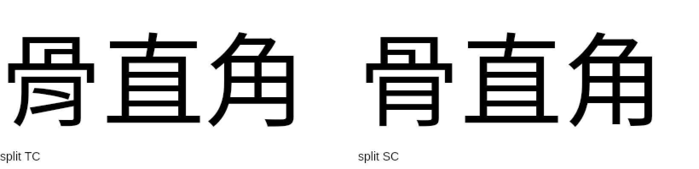
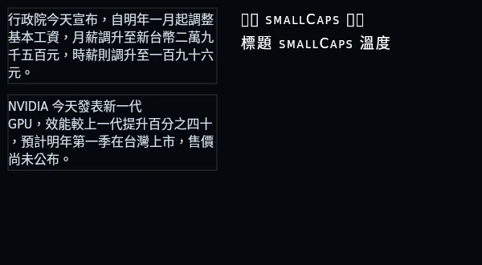
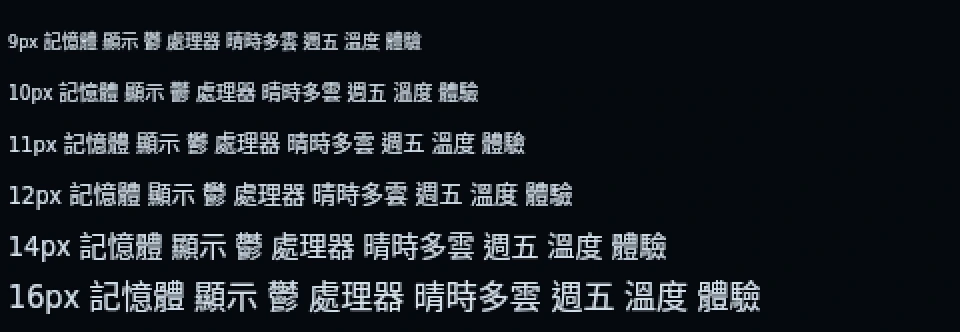
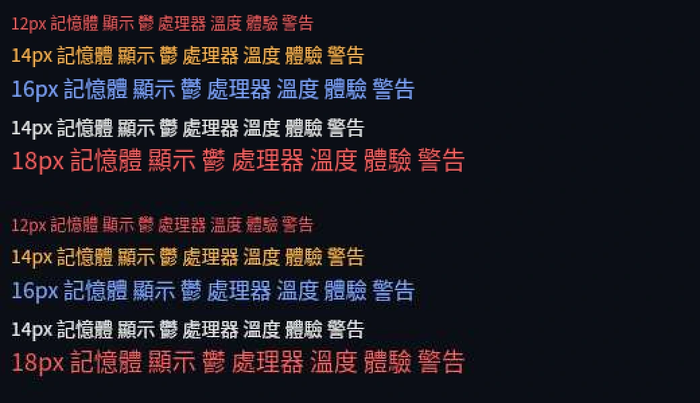

# Kiosko en chino: estudio y backlog para Taiwán y China

Fecha: 2026-11-20. Amplía el punto 10 del [plan](plan.md#pendiente)
(«Más idiomas, empezando por el chino»), que se queda como resumen y
apunta aquí.

**Objetivo:** que un usuario de un panel de Thermalright en Taiwán o en la
China continental instale Kiosko, lo use y lo recomiende sin chocar con
nada: ni textos en inglés, ni cuadros vacíos, ni letras ilegibles, ni colores
que digan lo contrario de lo que quieren decir. Y que el propio fabricante
lo vea como algo útil para sus clientes.

**Cómo se hizo:** revisión del código de `kiosko` y de los 16 plugins
oficiales (editor, web, panel, instalación), pruebas de pintado reales con
`@napi-rs/canvas` y las fuentes Noto CJK, e investigación de mercado en la
web. Lo que no se pudo comprobar está al final (§10).

---

## 0. Resumen

1. **Hoy el panel no puede pintar chino.** Solo lleva DejaVu, y
   `@napi-rs/canvas` no busca en las fuentes del sistema los caracteres que
   faltan: cada carácter chino sale como una caja vacía (*tofu*). La familia
   por defecto del kit (`'sans-serif'`) ni siquiera pinta la caja. Es lo
   primero y lo que bloquea todo lo demás (§3.1).
2. **Peor aún, el editor sí lo enseña.** La vista previa del editor y la
   demo web pintan en el navegador, que sí recurre a las fuentes del sistema:
   el usuario ve chino en la pantalla del ordenador y cuadros vacíos en el
   panel.
3. **Tradicional y simplificado se mezclan.** El código parte `zh-TW` en
   `zh` y no conoce la escritura (`Hant`/`Hans`). Un taiwanés acabaría viendo
   simplificado, o glifos japoneses, si la fuente se carga desde un `.ttc`
   (§3.2).
4. **Tamaño: el chino necesita más píxeles que el latín.** En estos paneles
   (≈ 170–215 ppp) los caracteres tradicionales densos (體, 顯, 鬱) son
   manchas por debajo de 12 px. El suelo razonable es ≈ 16 px, y lo cómodo,
   24–27 px. Hoy hay plugins con textos de 8–10 px y no hay ningún mínimo por
   escritura (§4).
5. **Color: el rojo es «sube» en bolsa**, y además el texto rojo y azul
   pequeño es el que peor sobrevive al JPEG que se envía al panel. Hay que
   separar «variación» de «estado» en los temas antes de que exista el
   plugin de finanzas (§5).
6. **Traducción:** unas 260 claves del editor y unos 1 100 textos de
   plugins, todos ya centralizados (`Localized`). Es trabajo de traducción y
   revisión nativa, no de arquitectura.
7. **Mercado:** Thermalright (利民, 索摩樂科技) tiene la sede en Taipéi. Su
   programa oficial, TRCC, es solo para Windows, con quejas frecuentes, y se
   limita a fondos más sensores. La alternativa para Linux (`trcc-linux`)
   ya habla 38 idiomas, chino incluido. El hueco de Kiosko es el **mosaico
   de información**, con datos locales que nadie ofrece: calendario lunar y
   節氣, festivos con 调休, el tiempo y las alertas de terremoto y tifón de
   la CWA, y la bolsa con los colores de allí (§6, §7).
8. **Orden recomendado:** primero Taiwán en tradicional, porque es la casa
   del fabricante, tiene datos abiertos y no hay cortafuegos. El
   simplificado sale a la vez, porque cuesta poco más con el mismo trabajo.
   La China continental exige además espejos (npmmirror, Gitee, descargas
   fuera de GitHub) y fuentes de datos propias.

Estimación gruesa, solo de código, sin traducción: **fase 0 + 1 + 2 ≈ 3–4
semanas** de trabajo para tener «cero fricción» en el producto. La web, la
instalación y los plugins locales van después y por partes (§8).

---

## 1. Alcance: qué chino

- **Tradicional (`zh-Hant`):** Taiwán (`zh-TW`) y Hong Kong/Macao (`zh-HK`,
  `zh-MO`). Taiwán no usa el simplificado: el **simplificado (`zh-Hans`)**
  es el de la China continental y Singapur (`zh-CN`, `zh-SG`).
- No son una traducción con dos alfabetos. El vocabulario técnico cambia:

  | Concepto | Taiwán | Continente |
  |---|---|---|
  | Ajustes | 設定 | 设置 |
  | Pantalla | 螢幕 | 屏幕 |
  | Plugin | 外掛 (o 擴充功能) | 插件 |
  | Memoria | 記憶體 | 内存 |
  | Software | 軟體 | 软件 |
  | Red | 網路 | 网络 |
  | Información | 資訊 | 信息 |
  | Archivo | 檔案 | 文件 |
  | Predeterminado | 預設 | 默认 |

  Una conversión automática (OpenCC) cambia los caracteres pero no estas
  palabras (a lo sumo con su perfil `s2twp`, y aun así hay que revisarlo).
  Hacen falta un **glosario por región** y revisión nativa de cada una.
- **Hong Kong:** al principio reutiliza `zh-TW` y la fuente TC (la HK
  difiere poco). Más adelante, si alguien lo pide, se separa.
- Las fuentes también difieren por región aunque el carácter Unicode sea el
  mismo (unificación Han): 骨, 直 y 角 se dibujan distinto en TC y en SC.
  Un taiwanés nota enseguida una fuente «de fuera».

  

---

## 2. Mercado

### 2.1 Thermalright

- **Empresa:**
  - Sede e I+D en Taipéi desde 2001.
  - Razón social 索摩樂科技股份有限公司.
  - Marca comercial **利民** en ambos mercados.
  - Tiene web propia en el continente, `thermalright.com.cn`, con ICP.
- **Canales:**
  - China continental: JD (tienda «利民Thermalright自营旗舰店»).
  - Taiwán: 原價屋 (CoolPC) es el escaparate clave, con reseñas largas de
    cada producto con LCD.
  - Resto del mundo: Amazon y Newegg.
- **Pantallas LCD:** del 2,4″ (Frozen Warframe, 320×240) al 9,16″ (Trofeo
  Vision; 1920×480 según las tiendas y 1920×462 según `trcc-linux` y
  nuestro preset). En medio hay 480×480 redondos de AIO, el PA120 Vision Max
  de 5″ a 480×854, 1280×480 y 1920×400. `trcc-linux` cuenta 16
  resoluciones.
- **TRCC 2.1.8 (Windows):**
  - Elige el idioma del sistema, con simplificado, tradicional e inglés al
    menos.
  - Hace temas, fondos y vídeo, y superpone sensores.
  - Quejas habituales: no detecta el panel, «index out of range», la
    galería no llega a la pantalla, la web de descargas falla (el instalador
    de simplificado tiene un espejo en 123pan) y se queda corto frente a
    AIDA64.
- **Relación con desarrolladores:** no hay SDK ni programa de socios. El
  contacto es por formulario («Sales & Business») y por un correo de
  colaboraciones de marketing. Hay precedentes de meses sin respuesta.

### 2.2 Competencia y qué se pone en estas pantallas

- **Programas:**
  - AIDA64 SensorPanel, que es la referencia y es difícil de adaptar.
  - Turing Smart Screen (图拉丁), solo para Windows.
  - Wallpaper Engine combinado con AIDA64 o HWiNFO, muy usado en China para
    la «pantalla secundaria» (机箱副屏).
  - Corsair, que acaba de abrir su Widget Builder: un ecosistema de widgets,
    como el nuestro.
- **Contenido** (escaparates en Bilibili y Douyin): sensores; relojes
  (minimalistas, Nixie, con fotos); el tiempo; **fecha del calendario lunar
  (农历) junto a la hora**; cuentas atrás; anime, 二次元 y GIF.
- **En Linux**, `thermalright-trcc-linux` (GPL-3.0, ~250 estrellas,
  reseñado en Tom's Hardware en 2026-02) ya lleva **simplificado y
  tradicional** entre sus 38 idiomas. Kiosko solo en inglés y español
  quedaría peor en una comparación directa.

### 2.3 Posicionamiento

Kiosko no compite con TRCC en «poner un fondo y la temperatura». Es **lo que
TRCC no hace**: un mosaico de información viva, editable en el navegador,
con plugins. Para el fabricante es un argumento de venta del Trofeo Vision
(una barra de 1920 px pide información, no un GIF) y para el usuario
avanzado, una alternativa en Linux y en Windows.

---

## 3. Hallazgos técnicos

### 3.1 Fuentes del panel (bloqueante)

- **Solo DejaVu:** `packages/core/src/fonts.ts` registra cuatro ficheros de
  DejaVu, y `@napi-rs/canvas` **no recurre a las fuentes del sistema**:
  cajas vacías. `setDefaultFamily('sans-serif')`
  (`lcd-canvas-kit/src/text.ts:8`) no pinta nada.
- **La solución probada es una lista de familias** en la cadena de fuente,
  `"KioskoSans", "Noto Sans CJK TC"`. Con ella el latín sale en DejaVu y el
  chino en Noto, carácter a carácter. Registrar la CJK con el mismo nombre
  de familia **sustituye** a DejaVu (gana el último), no la completa.
- **Un `.ttc` registrado por ruta trae solo su primera cara**, que en el
  `NotoSansCJK-Regular.ttc` del sistema es la **japonesa**. Hacen falta OTF
  por región (TC, SC), o pedir la familia del sistema por su nombre exacto.
- **Dónde se arregla:**
  - Los plugins pintan con el `ctx.kit` del núcleo, así que cambiando
    `text.ts` se cubren unas 250 llamadas.
  - Quedan aparte las que montan la cadena a mano: título de tesela
    (`compositor.ts:306`), `plugins/core`, el plugin de los gatos (48
    `ctx.font =`) y `mirror`.
- **Peso de las fuentes:** Noto Sans CJK es OFL-1.1, así que se puede
  distribuir. Pero una región en un peso son ≈ 16 MB en OTF completo
  (DejaVu Condensed: 0,7 MB). Opciones, en orden:
  1. Usar la fuente del sistema si existe: Windows tiene `Microsoft JhengHei`
     (TC) y `Microsoft YaHei` (SC); macOS, `PingFang TC/SC`; Linux, `Noto
     Sans CJK TC/SC` si está instalada.
  2. Si no, descargarla al elegir el idioma: OTF regional Regular + Bold,
     con suma de comprobación, en `dataDir`, no en caché, y desde un sitio
     al que llegue el continente (npm/npmmirror sirve: un paquete
     `@kiosko/fonts-cjk-tc` / `-sc`).
  3. Para la demo web, subconjuntos por `unicode-range` (los trocea Google
     Fonts, pero no se puede depender de Google en China: alojarlos
     nosotros).
- **El peso importa, no solo la familia.** En un panel con fondo oscuro, los
  trazos finos del Regular a 14–16 px se pierden. Conviene usar **Medium**
  para el cuerpo y Bold para los títulos (Noto CJK tiene 7 pesos). Hay que
  medirlo en un panel real.

### 3.2 Idioma: elegir bien tradicional o simplificado

- **`localize()`** (`sdk/src/i18n.ts`) busca `text['zh-TW']` y luego
  `text['zh']`:
  - `zh-Hant-TW`, `zh-HK` y `zh-MO` nunca llegan a una clave `zh-TW`.
  - Distingue mayúsculas.
  - Si un plugin pone `zh` (ya pasa en una prueba: `zh: '网址'`, que es
    simplificado), los taiwaneses reciben simplificado.
- **`loc()` del editor** (`web/src/i18n.ts:549`) pasa la etiqueta a
  minúsculas y luego busca `zh-tw`: no casa nunca con `zh-TW`.
- **El editor y la web** deciden con `startsWith('es')` en unos diez
  sitios; todo lo demás es inglés.
- **Arreglo:** un único `resolveLang(tag, disponibles)` en `@kiosko/sdk` con
  `new Intl.Locale(tag).maximize()`:
  - Todo lo `Hant` (TW, HK, MO) va a `zh-Hant`.
  - Todo lo `Hans` (CN, SG y `zh` a secas) va a `zh-Hans`.
  - Cadena de búsqueda: exacta → idioma-escritura → escritura → `en`.
  - Las claves de los plugins pasan a ser `zh-Hant` y `zh-Hans`, y el
    linter de plugins avisa de una `zh` a secas.
  - El mismo resolvedor elige la fuente (TC/SC) y el `lang` del HTML.

### 3.3 Formatos (`ctx.fmt`)

- **`sdk/src/format.ts` solo tiene palabras en inglés y español.** En chino
  pintaría «5 min ago», «2 d 3 h» y, en Taiwán, **«3:05 PM»** (zh-TW usa 12 h
  según `Intl`). En chino la marca va delante: **下午 3:05**.
- **Fechas con `Intl`**, ya correctas: «11月20日 週五» en Taiwán, «周五» en
  el continente.
- **Fallo en el calendario:** `calendar/draw.ts:126,273` monta «星期五 20» a
  mano. Debería ser «11/20（五）» o «20日 週五», con `Intl`.
- **Números grandes:** 萬/億 en Taiwán, 万/亿 en el continente.
  `Intl.NumberFormat(locale, { notation: 'compact' })` da «1.2億». Los
  contadores de `usage`, `gpu` y `llm` usan k/M a mano.
- **Primer día de la semana:** domingo en Taiwán, lunes en el continente
  (`Intl.Locale(...).weekInfo`). El editor y `cats` fuerzan el lunes.
- **Año 民國** (año − 1911, «115年»): se usa en contextos oficiales de
  Taiwán. Como opción, no por defecto (`zh-TW-u-ca-roc`).

### 3.4 Maquetación del texto en el panel

- **Partir líneas:** `fitPrefix`/`wrapLines` (`lcd-canvas-kit/src/text.ts`)
  vuelven al último espacio.
  - En chino puro corta por carácter, que vale.
  - En texto mixto (`NVIDIA 今天發表…`) vuelve al espacio lejano y deja
    media línea vacía.
- **Kinsoku:** no hay reglas, así que una línea puede empezar por `，。、」）`
  y acabar en `「（`.
  - **Arreglo:** oportunidades de corte con `Intl.Segmenter` o una UAX#14
    reducida (se puede cortar entre dos caracteres CJK), más una tabla de
    caracteres prohibidos al principio y al final de línea, empujando un
    carácter.
- **Altura:** el carácter Han sube ≈ 0,12 em por encima de la mayúscula
  latina. Las filas calculadas desde la altura de mayúscula pueden quedar
  justas; hay que revisarlas en `news`, `calendar` y `system/health`.
- **Versalitas y `tracking`** no hacen nada malo en chino, pero separar los
  caracteres de un título (`tracking: 2*s`) queda raro: espaciado 0 cuando
  el texto es CJK.
- **Anchura:** un carácter chino ocupa 1 em y uno latino ≈ 0,6 em. Los
  textos en chino tienen menos caracteres pero ocupan parecido. No hace
  falta rehacer anchos.

### 3.5 Editor web

- **Textos:**
  - ≈ 262 claves en `web/src/i18n.ts`, tipadas, así que `tsc` detecta las
    que faltan.
  - Otras ≈ 14 en la demo y 7 etiquetas `x-ui` del esquema.
  - Unos pocos textos fijos: «Docs», «Cannot reach the Kiosko service»,
    «Reset», «Madrid».
  - Los errores del servidor llegan en inglés a los avisos.
- **Frases troceadas** que en chino no casan (necesitan clasificador: 個/个,
  y otro orden): `{n} + 'frames sent'`, `{n} widgets`,
  `data.updated + hora`. Hay que convertirlas en plantillas completas.
- **`<html lang="en">` fijo:** el navegador elige mal los glifos Han y el
  lector de pantalla lee el chino como inglés.
- **CSS:**
  - Ninguna pila de fuentes con CJK.
  - 24 reglas por debajo de 12 px; la barra lateral está a 10–10,5 px.
  - 10 reglas `uppercase` con espaciado.
  - Títulos con espaciado negativo y `line-height: 1.04`.
  - Pesos 550/620/680 que las CJK del sistema no tienen (negrita sintética).
  - Necesita reglas `:lang(zh)`.
- **IME (pinyin/zhuyin):** ningún `isComposing`.
  - En el campo de etiquetas, Intro confirma el candidato del IME y a la
    vez añade una etiqueta a medio escribir.
  - Como separador no acepta la coma china `，` ni `、`.
- **Horas:** `toLocaleTimeString()` sin locale sigue al navegador y no al
  ajuste de 12/24 h, así que el editor puede decir 下午2:05 y el panel 14:05.
- **Selector de idioma:** solo automático, español e inglés. Un usuario
  `zh-TW` no ve ninguno marcado.

### 3.6 Web (kioskolcd.dev)

- **Bien:** no carga nada de Google ni de CDN de terceros; las fuentes son
  propias.
- **Mal:**
  - Es **una sola página con todos los idiomas dentro** (`` y una
    regla CSS que oculta el otro). Con tres o más idiomas no escala, y sin
    URL por idioma no hay `hreflang`: Google y Baidu indexan inglés.
  - Título, descripción y `og:` solo en inglés.
  - La galería y los carteles solo se pintan en `en` y `es`.
- **Alojamiento:** GitHub Pages llega a la China continental, pero lento e
  intermitente. Alojar en el continente exigiría ICP. Para empezar basta con
  que sea ligera y no dependa de nada bloqueado.

### 3.7 Instalación

- **npm:**
  - `npm i -g kiosko` respeta `.npmrc`, así que con npmmirror funciona.
  - La comprobación de actualizaciones tiene **`registry.npmjs.org` fijo**
    (`core/src/plugin-updates.ts:15`): en China va lenta o caduca.
- **Instalador de Windows:**
  - Se descarga de GitHub Releases, a menudo estrangulado en China.
  - Inno Setup solo está en inglés y español, con textos de tareas fijos.
    Hay `ChineseTraditional.isl` y `ChineseSimplified.isl`.
  - Hay que probar una carpeta de usuario con caracteres chinos
    (`C:\Users\王小明\…`) con los módulos nativos (`usb`, `canvas`) y el
    lanzador.
- **Documentación** solo en inglés, incluida la de USB/Zadig, que es donde
  más se atasca la gente.

---

## 4. Legibilidad: cuántos píxeles necesita un carácter chino

- **Por qué hace falta más que en latín:** un carácter latino se reconoce
  por su silueta; uno chino denso (體, 23 trazos) necesita que se separen los
  trazos.
  - Por debajo de 12 px, 鬱/體/顯/憶 se funden.
  - A 12 px solo se leen los sencillos.
  - De 14 a 16 px se leen todos.
- **Cuánto mide un píxel en cada panel**, a una distancia típica de 60 cm
  (panel pegado a la caja del PC junto a la mesa). Ángulo en minutos de arco
  (′): 1′ a 60 cm ≈ 0,175 mm; el carácter CJK ocupa ≈ 0,88 del cuerpo.

  | Panel | ppp | mm/px | Suelo CJK (≈ 10′) | Cómodo (≈ 16′) |
  |---|---|---|---|---|
  | Trofeo Vision 9,16″ 1920×462 | 216 | 0,118 | 17 px | 27 px |
  | 6,86″ 1280×480 | 199 | 0,128 | 16 px | 25 px |
  | 11,3″ 1920×400 | 174 | 0,146 | 14 px | 22 px |
  | 3,4″ 480×480 (AIO) | 200 | 0,127 | 16 px | 25 px |
  | 5″ 480×854 (PA120 Vision Max) | 196 | 0,130 | 15 px | 25 px |
  | 2,4″ 320×240 (Frozen Warframe) | 167 | 0,152 | 13 px | 21 px |

  Con la cabeza a 80 cm (pantalla del AIO dentro de la caja, bajo la mesa),
  todo ×1,33. Las normas de ergonomía (ISO 9241-303) piden ≈ 16′ como mínimo
  para leer y 20–22′ como recomendado, y más para ideogramas complejos.
  Nuestra «cómoda» es ya el mínimo de la norma: el panel se mira de reojo,
  no se lee de corrido.
- **Qué hay hoy:**
  - Varios plugins bajan a 8–10 px: `agents` (10), `usage` (9–10), las
    tarjetas de Home Assistant (9), las horas del tiempo (9, y `fitSize`
    hasta 8), `timesheet` (9), los subtítulos del calendario (10), `gpu`
    (10), `llm` (9), `mirror/tasks` (8) y la entradilla de `news` (11).
  - En chino todo eso es ilegible. En latín ya está por debajo de 6′:
    también mejoraría para todos.
  - Solo existe el `zoom` por widget (0,5–2). No hay ni densidad global ni
    mínimo por escritura.
- **Propuesta:**
  1. Cada preset de panel lleva su **diagonal en pulgadas**, para tener
     mm/px.
  2. Cada pantalla tiene un ajuste **«Distancia de lectura»**: cerca 40 cm,
     normal 60 cm, lejos 90 cm.
  3. El kit deriva un **`minTextPx` por escritura**: CJK ≈ 10′, latín ≈ 7′.
     Lo aplica en `glyphs()` a los caracteres CJK (subir el cuerpo, no
     escalar el dibujo) y ofrece `ctx.kit.minText` a los plugins para que
     maqueten con él (menos filas, no letras más pequeñas).
  4. Un **«Tamaño del texto» global** por pantalla que multiplique el `zoom`
     de todos los widgets.
  5. En el editor, un **aviso por tesela**: «En este panel, a 60 cm, este
     texto no se lee», con el botón de subir el tamaño. Y una **vista a
     tamaño real** (mm reales en el monitor, con la escala del monitor),
     porque la vista previa ampliada engaña: lo que se ve bien en el
     editor puede no verse en el panel.
  6. Una prueba automática que pinte cada widget en `zh-Hant` a 320×240 y
     falle si algún texto CJK cae por debajo del mínimo.

---

## 5. Colores y su significado

### 5.1 Subir y bajar

- **En Taiwán, la China continental y Japón, rojo = sube y verde = baja**
  en bolsa, cripto y cualquier variación de un valor. Es al revés que en
  Occidente.
- **Pero el rojo sigue siendo peligro** en alarmas, errores y semáforos:
  `alert`, `warn` y `ok` se quedan como están.
- **Riesgo hoy:** los temas (`sdk/src/theme.ts`) solo tienen
  `ok/warn/alert/info/accent`. Ningún widget actual pinta variaciones con
  rojo y verde: la tendencia de Home Assistant es gris con flecha y
  `timesheet` usa azul y ámbar. El riesgo llega con el plugin de finanzas
  (punto 13 del plan).
- **Qué hacer, antes de ese plugin:**
  - Tokens `up`/`down` en el tema.
  - Ajuste «Color de las subidas: verde / rojo», con el valor por defecto
    del idioma (`zh`, `ja`; también `ko` en bolsa).
  - Regla en `docs/plugins.md`: las variaciones van con `up`/`down` y
    flecha o signo, nunca con `ok`/`alert` (ayuda también a los daltónicos).

### 5.2 El color pequeño y el JPEG

- **El problema:** el panel recibe JPEG (calidad 90 por defecto, menos si el
  fotograma pasa de `maxKB`). El JPEG guarda el color a media resolución
  (submuestreo 4:2:0), así que **el texto rojo o azul pequeño pierde
  trazos** antes que el blanco. En chino, con trazos de 1 px, se nota mucho
  más.
- **El rojo es justo el color de las alertas** y el de «sube».
- **Qué hacer:**
  - Comprobar si `@napi-rs/canvas` permite JPEG 4:4:4. Si no, valorar otro
    codificador solo para paneles con texto CJK.
  - En los temas, que los textos de estado pequeños usen un tono claro del
    color (rosa claro en vez de rojo puro), o el color como fondo de una
    etiqueta con texto blanco.
  - Medir los KB por fotograma con texto CJK: más detalle significa
    fotogramas más grandes, y el límite de ~500 KB de los paneles LY sigue
    ahí.

### 5.3 Otros significados

- **Rojo y dorado:** suerte, fiesta y Año Nuevo Chino.
  - Un **tema «春節/春节»** (rojo, dorado, farolillos; el gato con un sobre
    rojo, 紅包) es barato y muy agradecido.
  - Sale cada año entre enero y febrero.
- **Blanco y negro** son colores de luto; no son un problema en un tema
  oscuro, pero no conviene combinarlos con crisantemos.
- **Revisar el arte de los gatos** con alguien de allí. Un gorro verde
  (戴綠帽 = cornudo) en un personaje es una broma involuntaria, y regalar un
  reloj (送鐘) suena a funeral (no afecta, pero ojo con los textos de
  regalo).

---

## 6. Plugins que tendrían sentido allí

Por valor/esfuerzo. Los cuatro primeros son los que más distinguen a Kiosko
de TRCC y de AIDA64.

| # | Plugin o cambio | Mercado | Datos | Esfuerzo |
|---|---|---|---|---|
| 1 | **Calendario lunar y 節氣/节气** en el widget de fecha del núcleo (農曆十月初一, 小雪), y 宜忌 como opción | TW + CN | Librería local `lunar-typescript` (6tail, MIT, sin red); o `Intl` con `calendar: 'chinese'` para lo básico | S |
| 2 | **Festivos y días laborables con 调休** (sábados laborables compensatorios en el continente), cuenta atrás al próximo festivo | TW + CN | TW: CSV oficial de 人事總處 en data.gov.tw. CN: `holiday-cn` (JSON, MIT). Necesita lista de «días laborables extra» por fecha en `workday` | M |
| 3 | **CWA (中央氣象署):** previsión, **avisos de terremoto y tifón a toda pantalla** (punto 27 del plan; los de terremoto son informes, no alerta temprana) | TW | Datos abiertos con clave gratuita; atribución obligatoria | M |
| 4 | **Bolsa con rojo sube**, 萬/億: TWSE (al cierre, oficial) y A股 (extraoficial) | TW + CN | Punto 13 del plan, con un proveedor por mercado; avisar de retraso | M |
| 5 | **Noticias en chino:** feeds por defecto según el idioma (中央社, 公視, 聯合; 澎湃, 新华) y agrupar titulares con bigramas CJK | TW + CN | RSS. Hoy el agrupado quita todo lo que no sea `[a-z0-9]`, así que con titulares chinos no agrupa nada | M |
| 6 | **Lo más visto:** Weibo, Zhihu, Bilibili, PTT | CN (+TW con PTT) | DailyHotApi, autoalojado (Docker/npm); extraoficial, desactivado por defecto | S |
| 7 | **Bilibili:** seguidores y «en directo» de un UP | CN | API extraoficial (error 412 si se abusa) | S |
| 8 | **Calidad del aire** (AQI) | TW + CN | 環境部 (clave); QWeather en el continente | S |
| 9 | **Consumo de IA china:** saldo de DeepSeek, y Qwen o Kimi si se puede, en `usage`/`llm` | CN | API oficial de DeepSeek | S |
| 10 | **Transporte de Taiwán (TDX):** bicis en mi estación de YouBike, próximo tren 台鐵/高鐵/捷運 | TW | OAuth2 con alta aprobada; 50 llamadas al día sin clave | M |
| 11 | **El tiempo en el continente:** QWeather (和风天气), 50 000 llamadas al mes gratis | CN | Clave y host propio por cuenta. Open-Meteo ya funciona en ambos, así que no es urgente | S |
| 12 | Números del **統一發票** cada dos meses | TW | Página pública del 財政部 | S |

Y adaptaciones de lo que ya existe:

- **`calls`:** detectar LINE (TW), WeChat, DingTalk, Feishu y 腾讯会议 (CN).
- **`mirror`:**
  - Los terremotos de la CWA en vez de EMSC para Taiwán.
  - Mapas y radar: OSM, RainViewer y TomTom van mal o no van en el
    continente; buscar alternativas o avisar.
- **Marco de fotos** (punto 16 del plan) **con GIF animado**: el uso
  número uno en China es el anime y 二次元 en la pantalla.
- **FPS del juego** (punto 19): lo más pedido en las pantallas de PC gaming
  de allí también.

---

## 7. Salir al mercado

1. **Antes de anunciarlo:** fases 0 a 2 del backlog terminadas y probadas en
   un Trofeo Vision real con `zh-TW`.
2. **Thermalright:**
   - Escribir en inglés y en tradicional por el formulario «Sales &
     Business» y al correo de colaboraciones de marketing.
   - Proponer:
     - aparecer como «software de la comunidad» en su página de descargas,
       junto a TRCC;
     - temas de lanzamiento para sus modelos nuevos;
     - que nos pasen la tabla de resoluciones y protocolos (aclarar 1920×480
       frente a 1920×462).
   - Pedirles revisión nativa de la traducción: es lo que menos les cuesta y
     lo que más compromete.
   - Seguir por escrito y también a través de 原價屋 o del distribuidor
     regional, porque responden despacio.
3. **Taiwán:**
   - Una presentación en PTT (`PC_Shopping`) y Mobile01 con fotos del panel
     (calendario lunar, tiempo de la CWA, alerta de terremoto).
   - Ofrecer a 原價屋 que lo incluya en sus reseñas de productos con LCD.
4. **Continente:**
   - Un vídeo en Bilibili «机箱副屏 / 冷头屏」 y una guía en 什么值得买 o
     Zhihu.
   - Un paquete de temas (二次元, 春节) listo para importar.
   - **Espejo del repo en Gitee** e instrucciones con npmmirror.
5. **Datos no oficiales** (Sina, Bilibili, Weibo): desactivados por defecto,
   con aviso de «uso personal, puede romperse». Los oficiales (CWA, TDX,
   data.gov.tw), con la atribución que piden, visible en la tesela.
6. **Con `trcc-linux`, colaborar en vez de competir.** Su licencia es GPL y
   la nuestra MIT: no copiar código, sí compartir la tabla de dispositivos y
   enlazarnos mutuamente.

---

## 8. Backlog

- **Tamaños:** S ≈ 1 día, M ≈ 2–5 días, L ≈ 1–2 semanas.
- **Criterio de aceptación de cada épica:** la definición de «cero
  fricción» (§9) aplicada a su parte.
- Las fases van en orden, pero dentro de cada una las tareas son
  independientes salvo que se diga.

### Fase 0: que el panel pinte chino (bloquea todo)

- **Z1. Fuentes CJK en el panel (L).**
  - Lista de familias de respaldo en el kit (`setFallbackFamilies`, usada por
    `glyphs`, `drawTracked` y `widthOf`) y un `fontString(size, family)`
    para los que montan la cadena a mano: `compositor.ts:306`,
    `plugins/core`, `cats` y `mirror`.
  - Quitar el `'sans-serif'` por defecto.
  - `core/fonts.ts` elige la fuente por escritura: primero la del sistema
    (JhengHei/YaHei, PingFang TC/SC, Noto CJK TC/SC) y si no, un paquete
    `@kiosko/fonts-cjk-tc` o `-sc` (OTF regional Regular + Medium + Bold)
    descargado al elegir el idioma.
  - Conectar por fin las familias extra de Ajustes (el parámetro `extra` de
    `registerFonts` nunca se pasa).
  - *Hecho cuando* la galería pintada en `zh-Hant` y en `zh-Hans` no tenga
    ni una caja vacía y los glifos sean TC o SC según el idioma, en Linux
    sin fuentes CJK, en Windows y en macOS.
- **Z2. Resolver el idioma con escritura (S).**
  - `resolveLang` con `Intl.Locale().maximize()` en `@kiosko/sdk`, usado por
    `localize`, `tr` y `loc` del editor (arregla el fallo de minúsculas), el
    almacén, la demo, la portada, `panel3d` y `starter`.
  - Las claves `zh-Hant`/`zh-Hans` en los `Localized`, y el linter avisa de
    una `zh` a secas.
  - Pruebas con `zh-TW`, `zh-Hant-TW`, `zh-HK`, `zh-MO`, `zh-CN`, `zh-SG`,
    `zh` y `zh-Hans-CN`.
- **Z3. Que la vista previa sea el panel (S–M).**
  - La demo y el editor cargan las mismas familias que el panel (con
    `unicode-range` y alojadas por nosotros).
  - El lienzo y el HTML llevan el `lang` resuelto.
  - *Hecho cuando* una captura del editor y el `frame.jpg` coincidan en
    glifos.

### Fase 1: que se lea

- **Z4. Tamaño mínimo por escritura y por panel (M–L).**
  - Diagonal en los presets.
  - «Distancia de lectura» por pantalla.
  - `minTextPx` por escritura en el kit, expuesto como `ctx.kit.minText`.
  - «Tamaño del texto» global por pantalla.
  - Aviso por tesela en el editor y vista a tamaño real.
  - Revisar los suelos de 8–10 px de `agents`, `usage`, `homeassistant`,
    `weather`, `timesheet`, `calendar`, `gpu`, `llm`, `mirror` y `news`, que
    pasan a maquetar con menos filas.
  - Prueba automática de tamaño mínimo (§4.6).
- **Z5. Partir líneas en chino (M).**
  - Cortes con `Intl.Segmenter` o reglas CJK.
  - Kinsoku de inicio y de fin.
  - Nada de retroceder a un espacio lejano en texto mixto.
  - Espaciado 0 en títulos CJK.
  - Revisar la altura de fila en `news`, `calendar` y `system`.
  - Pruebas con los textos de `wrap.png`.
- **Z6. Peso de la fuente y color pequeño en JPEG (M).**
  - Medir en el Trofeo real Regular frente a Medium, y JPEG 4:2:0 frente a
    4:4:4 o calidad más alta, en textos de 14–18 px de colores.
  - Ajustar los temas: tono claro para los textos de estado pequeños.
  - Medir los KB por fotograma.
  - **Necesita el panel físico.**

### Fase 2: que hable chino

- **Z7. `ctx.fmt` en chino (S).**
  - Palabras para `zh-Hant`/`zh-Hans`: 剛剛/刚刚, 5 分鐘前/5 分钟前, 小時,
    天, 週/周.
  - 上午/下午 **delante** de la hora.
  - Duraciones «1 小時 05 分».
  - Números compactos con `Intl` (萬/億, 万/亿) en un `fmt.compact` que usen
    `usage`, `gpu` y `llm`.
  - Fecha del calendario con `Intl` (`calendar/draw.ts:126,273`).
- **Z8. Editor en chino (M).**
  - Diccionarios `zh-Hant` y `zh-Hans` (≈ 262 + 14 claves), las etiquetas
    `x-ui` del esquema y el texto de bienvenida (`starter`).
  - Selector con nombres propios: 繁體中文 / 简体中文.
  - `<html lang>` dinámico.
  - CSS `:lang(zh)`: pilas de fuentes TC/SC, espaciado 0, sin `uppercase`,
    un mínimo de 12 px (barra lateral y etiquetas), `line-height` ≈ 1,25 en
    títulos y `line-break: strict`.
  - Frases troceadas convertidas en plantillas completas.
  - Errores del servidor con códigos y traducidos en el cliente.
  - Horas con el idioma de la aplicación y el ajuste de 12/24 h.
- **Z9. Escritura con IME (S).**
  - `isComposing`/`keyCode 229` en Intro y Retroceso del campo de
    etiquetas.
  - `，、；` como separadores.
  - Filtrar la biblioteca al terminar la composición.
  - Buscar también por el nombre en inglés cuando la interfaz está en chino.
- **Z10. Textos de los plugins oficiales (L, divisible).**
  - Primero lo que sale en el panel: `core`, `system`, `vitals`, `gpu`,
    `weather` (`labels.ts`), `calendar` y la fecha y la hora.
  - Después lo del editor: unos 1 100 textos en total, la mitad en
    `homeassistant` y `mirror`.
  - Publicar los plugins con su versión nueva.
- **Z11. Proceso de traducción (S, y luego continuo).**
  - Un fichero por idioma.
  - Glosario TW/CN (§1).
  - Primera versión con IA y **revisión nativa por región** (¿Thermalright?
    ¿alguien de PTT o de Bilibili?).
  - Prueba que falle con claves sin traducir, en el editor y en los plugins.
  - Una pseudolocalización para ver textos fijos que se cuelan.
  - Guía en `CONTRIBUTING.md` para aportar idiomas.

### Fase 3: convenciones

- **Z12. Subidas y bajadas (S).**
  - Tokens `up`/`down` en el tema.
  - Ajuste verde/rojo con el valor por defecto del idioma.
  - Regla en `docs/plugins.md`.
  - Antes del plugin de finanzas (punto 13 del plan).
- **Z13. Semana, festivos y calendario (M).**
  - Primer día de la semana desde `weekInfo`, en el editor y en `cats`.
  - **Días laborables extra por fecha** en `workday` (调休).
  - Fecha lunar y 節氣 opcional en el widget de fecha (§6.1).
  - Año 民國 como opción.
- **Z14. Revisión cultural del arte (S).** Gatos, interludios y textos de
  ejemplo, con alguien de allí (§5.3).

### Fase 4: web, instalación y documentación

- **Z15. Web por idioma (M–L).**
  - `/`, `/es/`, `/zh-Hant/`, `/zh-Hans/` generadas desde una tabla de
    textos.
  - Fuera la regla que oculta los ``.
  - `hreflang` (incluidos `zh-Hant-TW`, `zh-Hant-HK`, `zh-Hans-CN` y
    `x-default`), `canonical`, `og:locale`, títulos y descripciones
    traducidos, `sitemap`.
  - Menú de idioma en vez del conmutador.
  - Galería y carteles en los cuatro idiomas.
  - Imagen para compartir en chino (LINE, WeChat).
- **Z16. Instalar sin GitHub (M).**
  - La comprobación de actualizaciones usa el registro de `npm config`
    (`plugin-updates.ts:15`), con plazo corto.
  - Instrucciones con npmmirror (Node y paquete).
  - Instalador de Windows también desde una ruta alcanzable desde el
    continente (como paquete de npm, por ejemplo).
  - Inno Setup en TC y SC, con `[CustomMessages]`.
  - Prueba con un usuario de Windows con nombre chino.
  - Espejo en Gitee.
- **Z17. Documentación en chino (M).**
  - Inicio rápido, `docs/usb.md` (Zadig y udev) y preguntas frecuentes
    («TRCC y Kiosko a la vez», «no detecta el panel»).
  - El enlace «Docs» del editor lleva a la del idioma.
  - La guía de plugins puede esperar.

### Fase 5: plugins locales

En el orden de §6:

- **Z18.** Calendario lunar y 節氣 (si no entra en Z13).
- **Z19.** Festivos TW/CN con 调休.
- **Z20.** CWA con alertas a pantalla completa. Usa el mecanismo general
  de alertas del núcleo (punto 27 del [plan](plan.md#pendiente)), que va
  antes.
- **Z21.** Noticias en chino.
- **Z22.** Finanzas con TWSE y A股 (dentro del punto 13 del plan).
- **Z23.** Lo más visto (DailyHotApi).
- **Z24.** Bilibili.
- **Z25.** AQI.
- **Z26.** DeepSeek y Qwen en `usage`/`llm`.
- **Z27.** TDX.
- **Z28.** QWeather.
- **Z29.** `calls` con LINE, WeChat, DingTalk y Feishu.
- **Z30.** Tema «春節».
- **Z34. Gatos y agentes con proveedores disponibles en China (M).** Claude y
  Gemini no se ofrecen en China continental, y por eso la web en chino
  simplificado no ofrece hoy `agents`, `cats` ni `usage` (la lista de
  idiomas, `plugins.without`). Que `agents` (y con él la sala de los gatos)
  lea las sesiones de los agentes de programación de allí. Detalle en el
  punto 29 del [plan](plan.md#pendiente).

### Fase 6: mercado

- **Z31. Verificar en hardware real (S).**
  - Resolución real del Trofeo, y de los modelos de 2,4″, 3,4″ y 5″ si se
    consiguen.
  - Diagonales para los presets.
- **Z32. Contacto con Thermalright (S, de calendario largo).** §7.2.
- **Z33. Presentación en comunidades (M).** §7.3 y §7.4, con capturas y
  vídeo del panel en chino.

---

## 9. Qué significa «cero fricción» (prueba de aceptación)

Un usuario con Windows en `zh-TW`, sin nada instalado aparte:

1. Encuentra la web en Google en tradicional y la instrucción de
   instalación le funciona a la primera (y en el continente, con
   npmmirror).
2. El instalador y el editor están en 繁體中文 sin tocar nada. No se ve ni
   una palabra en inglés salvo nombres propios.
3. El panel pinta en tradicional con glifos TC, y se lee a 60 cm en el
   Trofeo Vision y en una pantalla de 2,4″.
4. La hora dice «下午 3:05» (o 15:05 si elige 24 h), la fecha «11月20日 週五»
   y, si quiere, «農曆十月初一».
5. Las palabras son las de Taiwán (設定, 螢幕, 外掛), no las del continente.
6. Escribir con zhuyin en cualquier campo no produce entradas a medias.
7. Una variación de bolsa en rojo es una subida.
8. Lo mismo para `zh-CN` con sus palabras, el lunes como primer día y las
   fuentes de datos y espejos que llegan desde allí.

Un usuario nativo de cada región hace esta prueba antes de anunciar nada.

---

## 10. Lo que no se ha podido comprobar

- **Opiniones en foros chinos:** las quejas sobre TRCC y lo que se enseña en
  Bilibili, Chiphell, PTT, 巴哈姆特, Mobile01 y Xiaohongshu (el buscador
  usado no los indexa bien).
- **Canales de Thermalright:** tiendas oficiales en Tmall, PChome, momo y
  Shopee; cuentas en Weibo y Bilibili; dónde está la fábrica.
- **Hardware:** la resolución exacta del Trofeo (1920×480 frente a 1920×462)
  y las diagonales de los modelos pequeños. La tabla de §4 usa las de las
  tiendas.
- **Software y servicios:** los idiomas exactos de TRCC, los límites
  gratuitos de TDX y del 環境部, y cómo funcionan hoy npm y npmmirror desde
  el continente.
- **Peso de las fuentes:** el de los subconjuntos regionales de Noto CJK
  (≈ 5–8 MB por peso, estimado).
- **Pruebas que necesitan el panel:** si `@napi-rs/canvas` permite JPEG
  4:4:4, y cuánto ganan Medium frente a Regular y la calidad JPEG en un
  panel real. Es la tarea Z6.
- **Los tamaños de §4** salen de una regla de ergonomía y de las pruebas en
  el monitor, no de usuarios reales. Hay que confirmarlos con alguien
  leyendo el panel.
